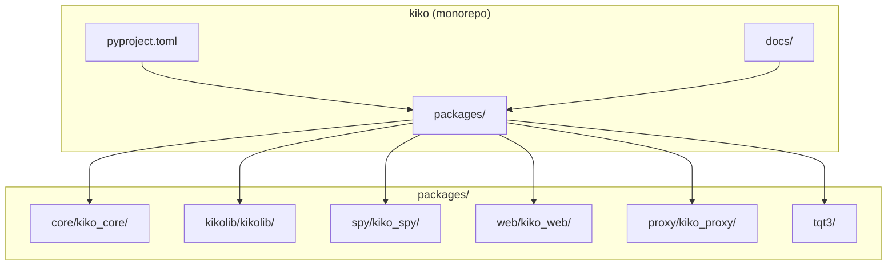
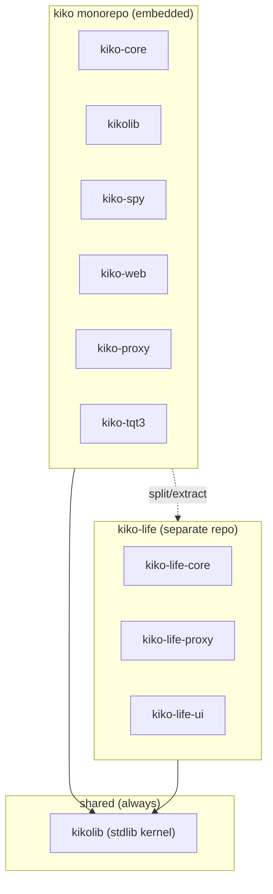
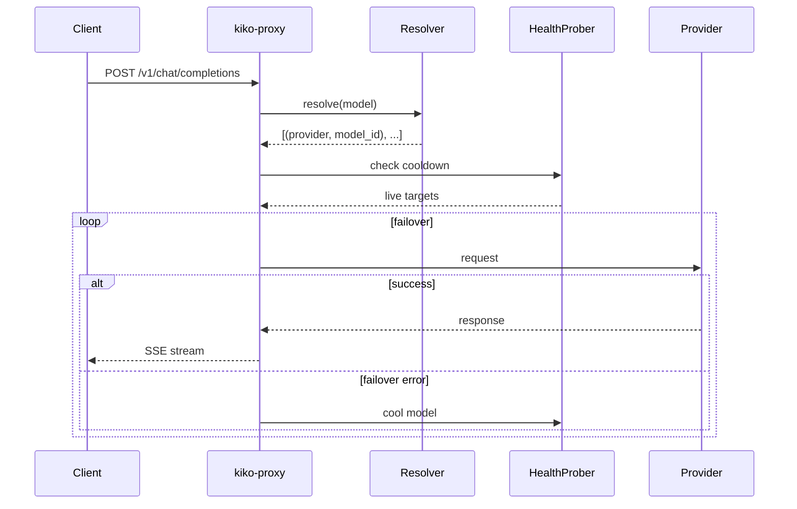
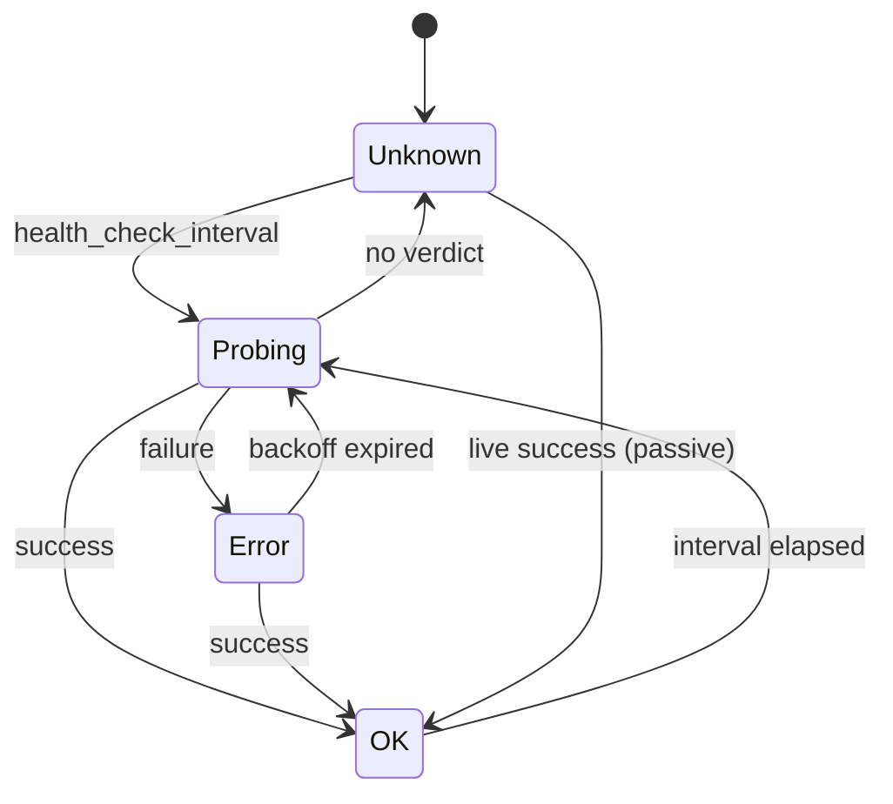
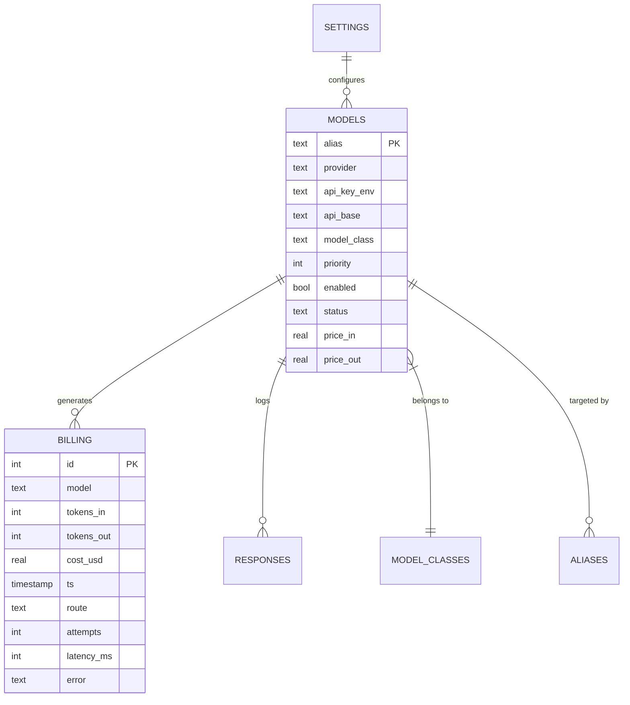

# How to Generate HTML Documentation with Mermaid Diagrams (kiko)

## Overview

The architecture documentation for kiko is generated as a single self-contained HTML file (`docs/architecture.html`) that includes:

- **Mermaid.js diagrams** rendered in-browser (no build step needed)
- **Fullscreen modal** for diagram viewing with zoom/pan
- **Responsive design** — works on mobile/tablet/desktop
- **All diagrams embedded** in the HTML — single file to share
- **Dark mode support** — follows system preference

## Prerequisites

- Mermaid.js loaded from CDN (`https://cdn.jsdelivr.net/npm/mermaid@10/dist/mermaid.min.js`)
- Modern browser with ES6 support
- No Node.js, Python, or build tools required for viewing

## File Structure

```
docs/
├── architecture.html          # Main documentation (self-contained HTML)
├── HOWTO_HTML_DOCS.md         # This file
├── KIKO_DOT_DIR.md            # ~/.kiko/ documentation
├── QUALITY_REPORT.md          # Code quality report
├── TEST_REPORT_*.md           # Test reports
├── tests-results/             # Test result artifacts (HTML/XML)
└── diagrams/                  # Optional: standalone .mmd files
    ├── monorepo-structure.mmd
    ├── request-flow.mmd
    ├── health-probe.mmd
    └── data-model.mmd
```

---

## Creating New Diagrams

### 1. Add Mermaid Code Block in HTML

Edit `docs/architecture.html` and add a new diagram section:

```html
<section id="your-section">
    <h2>Your Section Title</h2>
    <div class="diagram-container">
        <div class="mermaid" id="your-diagram-id">
flowchart TD
    A[Start] --> B[Process]
    B --> C[End]
        </div>
    </div>
</section>
```

### 2. Mermaid Diagram Types Supported

| Type | Syntax | Use Case |
|------|--------|----------|
| **Flowchart** | `flowchart TD` / `flowchart LR` | Process flows, sequences |
| **Sequence** | `sequenceDiagram` | API calls, interactions |
| **Class** | `classDiagram` | Data structures, models |
| **State** | `stateDiagram-v2` | State machines (health, cooldown) |
| **Git** | `gitGraph` | Branching workflows |
| **Gantt** | `gantt` | Timelines, releases |
| **ER** | `erDiagram` | Database schema |
| **Journey** | `journey` | User journeys |

### 3. Diagram Styling (CSS in HTML)

```css
.diagram-container {
    background: var(--card-bg, #fff);
    border: 1px solid var(--border, #e0e0e0);
    border-radius: 8px;
    padding: 1rem;
    margin: 1rem 0;
    overflow: auto;
}

.mermaid {
    display: flex;
    justify-content: center;
}

@media (prefers-color-scheme: dark) {
    .diagram-container {
        background: #1e1e1e;
        border-color: #444;
    }
}
```

### 4. Fullscreen Modal (built-in)

Diagrams are automatically included in the fullscreen modal via JavaScript:

```javascript
const diagrams = document.querySelectorAll('.mermaid[id]');
// Each diagram with an ID gets added to modal
```

**Requirement**: Each `.mermaid` div **must have a unique `id` attribute**.

---

## kiko-Specific Diagram Examples

### Monorepo Structure (Current)


### Future: kiko-life (Separate Project)


> **Note**: `kiko-life` е отделен проект (LiteLLM-compatible proxy). Тук базираме на `kiko-lite` (embedded версия). `kiko-life` ще се "chopne" (изреже) като отделен репо по-късно.

### Request Flow (kiko-proxy → providers)


### Health Probe State Machine


### Database Schema (ER)


---

## Updating Documentation

1. **Edit source Markdown** (if you maintain `.md` source): `docs/architecture-source.md`
2. **Update diagrams** in `docs/architecture.html`
3. **Open in browser** to verify: `xdg-open docs/architecture.html`
4. **Commit both files**

### Recommended Workflow

```bash
# 1. Edit diagrams in HTML (or standalone .mmd files)
vim docs/architecture.html

# 2. Verify in browser
xdg-open docs/architecture.html

# 3. Optionally export standalone .mmd files to diagrams/
cp "extracted diagram" docs/diagrams/new-diagram.mmd

# 4. Commit
git add docs/architecture.html docs/diagrams/*.mmd
git commit -m "docs: add X diagram"
```

---

## Viewing

```bash
# Linux
xdg-open docs/architecture.html

# macOS
open docs/architecture.html

# Windows
start docs/architecture.html

# Or serve locally (for CSP-restricted environments)
python3 -m http.server 8080 -d docs
# Then open http://localhost:8080/architecture.html
```

---

## Features

| Feature | Implementation |
|---------|----------------|
| **No build step** | Mermaid renders client-side from CDN |
| **Fullscreen** | Click "⛶ Fullscreen All" button |
| **Zoom/Pan** | Mouse wheel zoom, drag to pan in modal |
| **Dark mode** | Auto-detects `prefers-color-scheme` |
| **Printable** | CSS `@media print` styles included |
| **Responsive** | Works on mobile/tablet/desktop |
| **Keyboard nav** | `Esc` closes modal, arrows navigate |

---

## Adding New Sections (Checklist)

- [ ] Add `<section id="unique-id">` in HTML
- [ ] Add entry to Table of Contents (`.toc ul`)
- [ ] Include diagram(s) in `.diagram-container`
- [ ] Each `.mermaid` div has unique `id`
- [ ] Test in browser (light + dark mode)
- [ ] Update this HOWTO if new patterns emerge

---

## Reference Files

- **Template**: `docs/architecture.html` (edit this)
- **Source**: `docs/architecture-source.md` (optional, for content)
- **Standalone diagrams**: `docs/diagrams/*.mmd` (for embedding elsewhere)
- **Test results**: `docs/tests-results/*.html` (coverage reports)