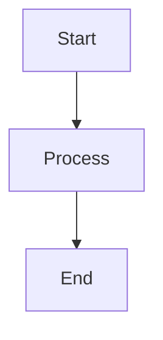

# HTML Documentation Generation (Mermaid → SVG)

This document describes how to generate and maintain self-contained HTML
documentation with Mermaid.js diagrams rendered as standalone SVG images,
based on `in/HOWTO_HTML_DOCS.md`.

## Overview

Documentation is a single self-contained HTML file (`doc/architekture.html`)
that embeds SVG diagrams generated from Mermaid source files. No client-side
JavaScript or CDN is needed for viewing.

## Prerequisites

- `npx -y @mermaid-js/mermaid-cli` (mmdc) — to render `.mmd` → `.svg`
- Modern browser with SVG support — for viewing
- No build step for viewing the HTML

## File Structure

```
doc/
├── architekture.html          # Main documentation (self-contained HTML)
├── diagrams/
│   ├── arch-overview.mmd      # Mermaid source
│   ├── arch-overview.svg      # Rendered SVG
│   ├── secret-flow.mmd
│   ├── secret-flow.svg
│   ├── db-schema.mmd
│   ├── db-schema.svg
│   ├── autodiscovery.mmd
│   └── autodiscovery.svg
```

## Creating or Updating a Diagram

### 1. Write the Mermaid source

Create or edit `doc/diagrams/<name>.mmd`:



### 2. Render to SVG

```bash
npx -y @mermaid-js/mermaid-cli -i doc/diagrams/<name>.mmd -o doc/diagrams/<name>.svg -t default -b white
```

### 3. Embed in HTML

Replace or add an `` tag in `doc/architekture.html`:

```html
<div class="diagram-container">
.svg" alt="Diagram description" style="max-width: 100%; height: auto;">
</div>
```

## Viewing the HTML

```bash
# Linux
xdg-open doc/architekture.html

# Or serve locally
python3 -m http.server 8080 -d doc
# Then open http://localhost:8080/architekture.html
```

## Recommended Workflow

```bash
# 1. Edit or create doc/diagrams/<name>.mmd
vim doc/diagrams/<name>.mmd

# 2. Render to SVG
npx -y @mermaid-js/mermaid-cli -i doc/diagrams/<name>.mmd -o doc/diagrams/<name>.svg -t default -b white

# 3. Verify in browser
xdg-open doc/architekture.html

# 4. Commit
git add doc/diagrams/<name>.mmd doc/diagrams/<name>.svg doc/architekture.html
git commit -m "docs: update <name> diagram"
```

## Diagram Types Supported by Mermaid

| Type | Syntax | Use Case |
|------|--------|----------|
| Flowchart | `flowchart TD` / `flowchart LR` | Process flows, sequences |
| Sequence | `sequenceDiagram` | API calls, interactions |
| Class | `classDiagram` | Data structures, models |
| State | `stateDiagram-v2` | State machines |
| ER | `erDiagram` | Database schema |
| Git | `gitGraph` | Branching workflows |

## Source

This procedure is based on `in/HOWTO_HTML_DOCS.md`.
