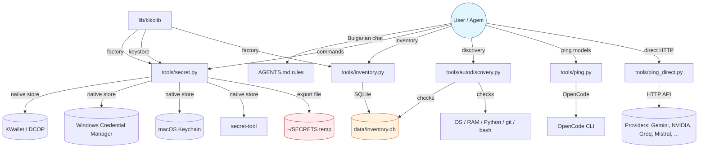
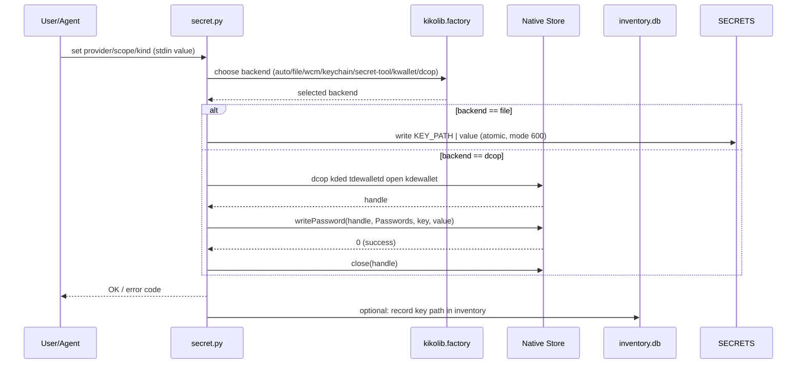
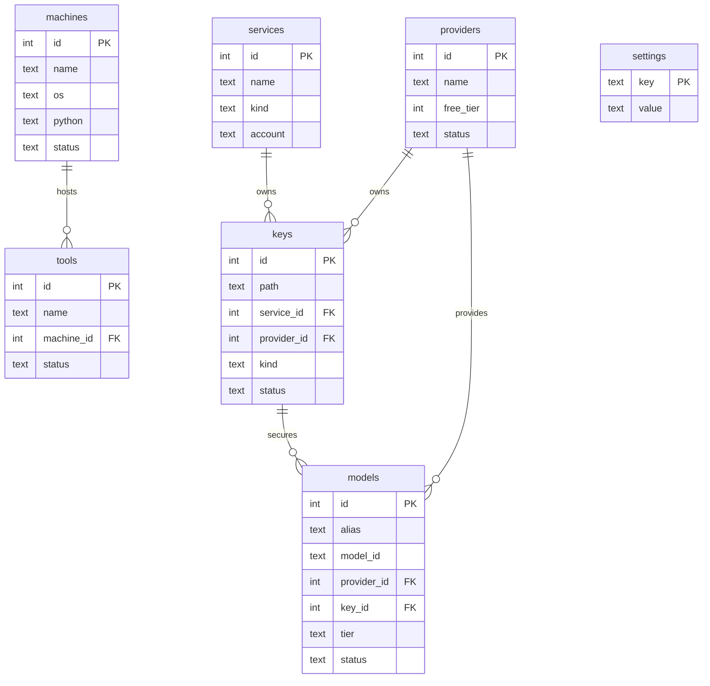
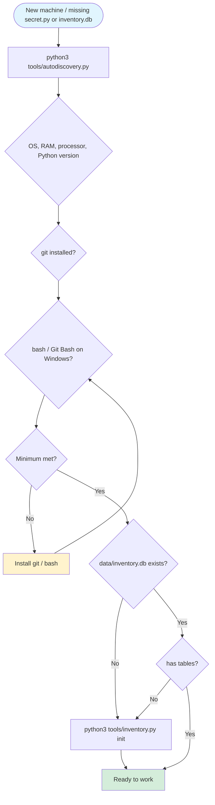

# Project Architecture — Portable Development Workspace

Self-contained, portable folder for AI-assisted software development.

## 1. Repository Layout

```
./
├── AGENTS.md              # project rules (single source of truth)
├── README.md              # entry point, how to continue on another machine
├── doc/
│   ├── architecture.html  # this file — architecture & UML diagrams
│   └── diagrams/
│       ├── arch-overview.mmd   # Mermaid source
│       ├── arch-overview.svg   # rendered SVG
│       ├── secret-flow.mmd
│       ├── secret-flow.svg
│       ├── db-schema.mmd
│       ├── db-schema.svg
│       ├── autodiscovery.mmd
│       └── autodiscovery.svg
├── lib/
│   ├── README.md              # vendored kikolib provenance & license
│   └── kikolib/               # vendored stdlib keystore + factory (MIT)
│       ├── __init__.py
│       ├── dotenv.py
│       ├── factory.py
│       ├── http_client.py
│       ├── keystore.py
│       ├── native_utils.py
│       ├── posix_utils.py
│       ├── retry.py
│       ├── server.py
│       ├── sse.py
│       ├── tokens.py
│       └── yaml_lite.py
├── data/
│   ├── schema.sql         # committed SQLite schema
│   ├── seed.sql           # committed initial inventory data
│   └── inventory.db       # local only, gitignored
├── docs/
│   └── procedures/        # step-by-step procedures (step-review, commit, HTML docs, ...)
├── tools/
│   ├── __init__.py
│   ├── secret.py          # portable secret tool over native stores
│   ├── inventory.py       # SQLite inventory manager
│   ├── autodiscovery.py   # machine discovery (OS, RAM, git, bash, db)
│   ├── ping.py            # model ping via OpenCode
│   ├── ping_direct.py     # direct HTTP ping to providers (KWallet keys)
│   ├── setup_providers.py # configure OpenCode providers from KWallet
│   └── tests/             # functional tests (57 tests, all pass)
│       ├── __init__.py
│       ├── secret.py
│       ├── inventory.py
│       ├── autodiscovery.py
│       ├── test_secret.py
│       ├── test_inventory.py
│       └── test_autodiscovery.py
├── out/                   # reports and test output, not versioned
├── .tmp/                  # temporary files, not versioned
└── .gitignore
```

## 2. Architecture Diagram — Component Interaction



## 3. Secret Tool Flow



## 4. Inventory Database Schema



## 5. Auto-Discovery Procedure



## 6. OpenCode Desktop — Visual Concept

OpenCode is a terminal TUI (Terminal User Interface) application — the entire interface runs in a single terminal window, without split GUI panes. Conceptual layout:

```
konsole — user@host: ~/ai-first-workspace
─────────────────────────────────────────────────────────────────────
 OpenCode v2 — Portable Workspace (Q4OS/TDE)
─────────────────────────────────────────────────────────────────────

 > zdr. suzdadem agents.md

 █  Разбирайки задачата, създавам AGENTS.md с правила за проекта...
 █  Правила: език, записи, самодостатъчност, технически изисквания,
 █  работни навици, без инициатива без разрешение.
 █
 █  Git операции: lokalen commit/push без дискусия.
 █  git push remote изисква изрично „да“.
 █
 █  Създавам AGENTS.md...
 █  [done] AGENTS.md written (126 lines)

 ─────────────────────────────────────────────────────────────────────
 > python3 tools/autodiscovery.py

 █  === Portable workspace auto-discovery ===
 █  OS: Linux 6.12 Q4OS (TDE)
 █  Processor: x86_64 | RAM: 7767 MB
 █  Python: 3.13.5 | git: yes | bash: yes
 █  Minimum met: git bash + Python stdlib are present.
 █  tools/secret.py: present
 █  tools/inventory.py: present
 █  data/inventory.db: exists
 █
 █  Notes: GitHub token and email are OPTIONAL.
 █  auto never falls back to plaintext.

 ─────────────────────────────────────────────────────────────────────
 > python3 -m unittest discover -s tools/tests -t . -v

 █  Ran 57 tests in 6.7s
 █  OK (skipped=1)
 █  ✓ All functional tests pass

 ─────────────────────────────────────────────────────────────────────
 █  Waiting for your command...
```

**Notes:** The entire interface runs in one terminal window (TUI). Chat is in Bulgarian Cyrillic. Project records are in English. Secret values are never printed — `list` and `probe` show only key paths. The KWallet/DCOP wallet on Q4OS must be opened once manually before `secret.py` can use it.

## 7. What Is Missing / Recommendations

- **OpenCode provider configuration:** Gemini, NVIDIA, DeepSeek, Mistral providers are not yet configured in OpenCode. Use `tools/setup_providers.py` to add them with keys from KWallet.
- **Live DCOP test:** Run `SECRET_LIVE_TESTS=1 python3 -m unittest discover -s tools/tests -t . -v` after opening the KWallet.
- **External audit:** before a release, follow `docs/procedures/release-audit.md`; reports go to `out/`.
- **Git remote:** No `origin` configured yet. Add remote and push when ready.
